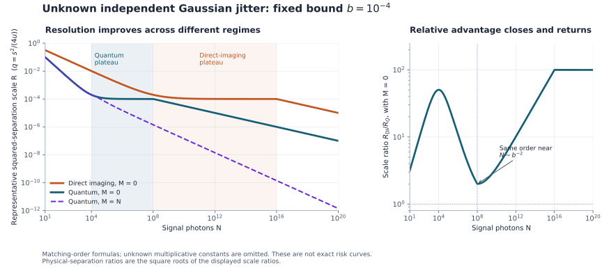

# Quantum Imaging Calibration

**How many calibration photons does quantum superresolution need when the image jitter is unknown?** This project gives matching quantum and direct-imaging resolution laws for two equal incoherent sources under independent Gaussian jitter, with the calibration sample counted explicitly.

For the independent-jitter, known-centroid experiment, the quantum lower bound permits every collective receiver on the signal and calibration photons. A fixed measurement with **four outcomes** attains the same order: the first three Hermite–Gaussian spatial modes and one outcome collecting the remaining modes.

## Sister project: motion, jitter and finite calibration

**[Quantum Imaging Timing](https://github.com/GoGoKo699/Quantum-Imaging-Timing) is the sister project.** It studies a common Brownian centroid and known photon-arrival gaps; this repository develops independent unknown jitter and charges the calibration sample. Their [joint frontier](science/timing-and-calibration.md) combines both motions with a fully specified stabilized point calibration source. Close photon pairs suppress the common motion, while independent physical jitter remains even with unlimited calibration.

Timing is the [authoritative home of the joint proof](https://github.com/GoGoKo699/Quantum-Imaging-Timing/blob/339a4ec9c2488d6a26b7bcb8d9d4168beecaba2e/science/joint-model.md). This repository retains the complete static theorem below and a self-contained joint-model consequence. The general joint receiver uses full HG mode resolution on relative spatial modes; the four-outcome statement above applies to the static theorem and, with a separate construction, the controlled close-doublet corollary. A SWAP parity bit alone is not assumed to implement that receiver.

## Main result

The known, real Gaussian point-spread amplitude has intensity variance $`u`$. Two sources have separation $`s`$ and known centroid. The unobserved jitter is redrawn independently for each photon, with one unknown variance $`v`$ shared by the signal and calibration distributions. Only the upper bound $`0\le v/u\le b`$ is supplied. There are $`N`$ signal photons and $`M`$ photons from a known point calibration source.

Define

```math
q=\frac{s^2}{4u},\qquad
K=\frac{NM}{N+M},\qquad
L=\max\{\sqrt N,K\},
```

with $`K=0`$ when $`M=0`$. For any fixed error target below $`1/2`$, the minimax resolution orders are

| Measurement class | Resolution scale in $`q`$ |
|---|---|
| Every quantum receiver | $`R_Q=N^{-1}+\min\{b,\sqrt{b/L}\}`$ |
| Position detection with arbitrary classical processing | $`R_{\mathrm{DI}}=N^{-1/2}+\min\{b,L^{-1/2}\}`$ |

The constants are uniform in $`N,M,b`$ for a fixed bounded noise range and a fixed local separation range. The [precise theorem](science/model-and-results.md#3-uniform-resolution-theorem) states the risk, quantifiers, endpoint cases and nonempty-alternative condition. These are matching orders, not exact leading constants. Physical separation is recovered through $`s=2\sqrt{uq}`$.

## Why the calibration budget matters

Separation and jitter both broaden an image. With no calibration and a small fixed bound $`b`$, quantum resolution follows the ideal $`q\asymp N^{-1}`$ law until $`N\asymp b^{-1}`$, remains of order $`b`$ through the range $`b^{-1}\ll N\ll b^{-2}`$, and then improves through a fourth-order shape signature. Direct imaging encounters its corresponding plateau later.

Around $`N\asymp b^{-2}`$, both methods have resolution of order $`b`$: their **scaling advantage closes**, even though their constants need not agree. More signal photons can restore a relative quantum advantage. Absolute quantum resolution never becomes worse as photons are added.



The figure evaluates the theorem's representative scales at $`b=10^{-4}`$. It displays asymptotic orders rather than exact error probabilities. [Interpretation](science/interpretation.md) derives the crossovers and explains why $`K\gg b^{-1}`$, rather than merely $`K\asymp b^{-1}`$, is needed to resolve parametrically below the uncertainty scale in the closing-advantage window.

## Read the science

Start with the [model and complete claims](science/model-and-results.md), then follow the converse or construction according to your question.

| To understand | Read |
|---|---|
| The optical experiment, nuisance parameter and fixed-error minimax task | [Model and results](science/model-and-results.md) |
| The lower bound against all joint quantum measurements | [Quantum converse](science/quantum-converse.md) |
| The exact Gaussian collision kernel and its operator domains | [Collision calculation](science/collision-kernel.md) |
| The four-outcome apparatus and three attaining tests | [Finite receiver](science/finite-receiver.md) |
| The matching limit and construction for position data | [Direct imaging](science/direct-imaging.md) |
| Temporary plateaus, relative advantage and calibration thresholds | [Physical interpretation](science/interpretation.md) |
| Common Brownian motion plus independent jitter, schedule dependence and calibration | [Joint timing/calibration consequence](science/timing-and-calibration.md) |
| Established ingredients, nearby models and source limits | [Related work](references/related-work.md) and [bibliography](references/references.bib) |
| Independent finite checks and reproduction commands | [Verification](verification/README.md) |

The [LLM reading guide](llms.txt) maps scientific questions to the authoritative pages.

## Learn the project

The single educational anchor is **Mankei Tsang, *Resolving starlight: a quantum perspective***, [arXiv:1906.02064v2](https://arxiv.org/pdf/1906.02064v2). The [Tsang bridge](learning/tsang-bridge.md) identifies the useful sections, translates the notation, and connects spatial-mode imaging to unknown jitter, charged calibration and the uniform testing theorem, then to the sister result for a moving centroid. Both repositories use this same source with project-specific bridges. It separates the review's foundations from the project's derivations and research-level proof dependencies.

The [30-milestone map](learning/milestones.md) gives a common route through the science. Its **12 background/preliminaries milestones** assemble the optical and statistical experiment; its **18 narrative/innovation milestones** connect nuisance compensation, the universal converse, finite-receiver attainment, the calibration frontier and its controlled transfer to a moving signal. Each milestone records an understanding target, dependencies, a conceptual connection and source pointers. Use the bridge alongside the map for self-directed study; the direct proof route above remains available.

## Reproduce the checks

With Python 3.11 or later, install the pinned numerical dependencies and run from the repository root:

```bash
python3 -m pip install -r verification/requirements.txt
python3 verification/run_all.py
```

The suite independently checks the collision formula using a truncated Hermite–Gaussian expansion and Gaussian quadrature, and checks the finite receiver using quadrature and exhaustive multinomial enumeration. It compares results with committed reference outputs within documented tolerances. The general minimax theorem is established by the written proofs; finite numerical checks do not certify uniformity or bibliographic priority. The [verification guide](verification/README.md) explains the checks and reproduces the figure.

## Scope and attribution

The model uses a known real Gaussian point-spread amplitude, known centroid and separation axis, equal incoherent sources, independent per-photon Gaussian jitter, and independent calibration photons with the same unknown variance. Counts are conditioned upon or have matched parameter-independent laws. These are the assumptions of the static theorem. The separate [joint timing/calibration result](science/timing-and-calibration.md) covers an unrestricted initial centroid and a common Brownian path on a supplied bounded schedule, with the specified independent calibration source. Shared jitter realizations, non-Gaussian noise, unknown diffusion and calibration mismatch remain outside those guarantees.

Classical Gaussian-mixture singularity, quantum spatial-moment advantages, Hermite–Gaussian detection and two-sample nuisance information are established ingredients. The account develops their joint uniform resolution frontier for this experiment, including an all-receiver converse and the calibration-dependent uncertainty plateau. The [source comparison](references/related-work.md) records both attribution and unresolved full-text access limits; it does not claim exhaustive priority certification.

## Purpose and contact

This repository serves as a record of the work and a guide for the author’s self-directed learning. For discussion or potential collaboration, please contact Ruge Lin at [gogoko699@gmail.com](mailto:gogoko699@gmail.com).
