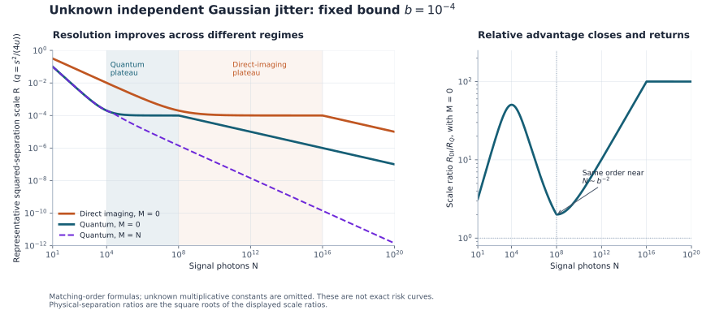

# What calibration changes

The [resolution theorem](model-and-results.md#3-uniform-resolution-theorem) is uniform in the known noise bound and both photon budgets. This page translates that theorem into physical regimes. Every displayed boundary is an order statement for a fixed error tolerance. Numerical prefactors and the exact finite-sample transition locations are not determined.

## A separation can imitate additional blur

A signal photon's latent coordinate is $`X=Z+Sa`$. Its variance is $`v+a^2`$. Consequently, two sources with a little less jitter can agree in variance with one source having a little more jitter. At small separation, the information that first escapes this compensation is a fourth-order shape change.

The position distribution has fourth cumulant $`-2a^4`$, independent of the Gaussian optical blur and Gaussian jitter. That classical cancellation is inherited from Gaussian-mixture statistics. Quantum mode measurements access the same shape change with smaller fluctuations when the jitter is weak. The [finite receiver](finite-receiver.md) realizes this advantage through the exact invariant

```math
p_0p_2-\frac32p_1^2
=-\frac{p_0^2q^2}{(2+B)^4},\qquad B=v/u.
```

Its null mean is zero for every allowed jitter variance. The issue is the number of photons required to distinguish its negative mean from its fluctuations. A calibration source supplies another route: learn the broadening shared by the two streams, so their difference can reveal separation at second order.

## Three quantum regimes

Let $`K=NM/(N+M)`$ and $`L=\max\{\sqrt N,K\}`$. Since $`L\le N`$ for $`N\ge1`$, the two crossover noise scales obey $`N^{-1}\le L^{-1}`$.

| Known variance bound | Quantum resolution order in $`q=s^2/(4u)`$ | Dominant explanation |
|---|---|---|
| $`b\lesssim N^{-1}`$ | $`N^{-1}`$ | The worst allowed jitter is below the ideal resolution floor |
| $`N^{-1}\lesssim b\lesssim L^{-1}`$ | $`b`$ | Broadening uncertainty masks the source separation |
| $`b\gtrsim L^{-1}`$ | $`\sqrt{b/L}`$ | Shape or calibration data resolve that uncertainty |

The middle regime can have a wide range of scales when calibration is scarce. If $`K\asymp N`$, its two boundaries are of the same order and it is no longer parametrically wide.

In the last regime, $`K\lesssim\sqrt N`$ gives the shape branch $`\sqrt b\,N^{-1/4}`$. For $`K\gtrsim\sqrt N`$, the calibrated branch is $`\sqrt{b/K}`$. The crossover count $`K\asymp\sqrt N`$ is relevant only after the known bound ceases to be the better way to resolve the nuisance.

## A temporary plateau as signal photons accumulate

Fix a small positive bound $`b`$ and set $`M=0`$. The quantum scale becomes

```math
R_Q=\frac1N+\min\{b,\sqrt b\,N^{-1/4}\}.
```

It has three asymptotic regions:

| Signal count | Squared half-separation $`q_Q`$ | Physical separation $`s_Q`$, up to constants |
|---|---|---|
| $`N\ll b^{-1}`$ | $`N^{-1}`$ | $`\sqrt u\,N^{-1/2}`$ |
| $`b^{-1}\ll N\ll b^{-2}`$ | $`b`$ | $`\sqrt{ub}`$ |
| $`N\gg b^{-2}`$ | $`\sqrt b\,N^{-1/4}`$ | $`\sqrt u\,b^{1/4}N^{-1/8}`$ |

The plateau is an order-of-magnitude statement: increasing $`N`$ across this range does not change the leading scale set by the unknown variance bound. It does not mean the exact minimax error or exact best resolution is mathematically constant. Absolute quantum resolution never worsens as photons are added; any receiver can discard extra observations.

For direct imaging,

```math
R_{\mathrm{DI}}=N^{-1/2}+\min\{b,N^{-1/4}\}.
```

Its corresponding plateau occurs later, between $`N\asymp b^{-2}`$ and $`N\asymp b^{-4}`$. Near $`N\asymp b^{-2}`$, both measurement classes resolve $`q`$ only to order $`b`$. Thus the **parametric quantum advantage closes around this crossover**, even though constants may still favor a quantum receiver.

For still larger counts, direct imaging remains near its plateau while the quantum shape test improves. At $`N\gg b^{-4}`$, both classes have the inherited $`N^{-1/8}`$ physical-separation exponent, but their weak-noise prefactors differ by a factor of order $`b^{1/4}`$ in separation. A relative advantage can therefore close and reopen while both absolute resolutions improve or stay at their respective order plateaus.



The figure evaluates the theorem's representative scales $`R_Q`$ and $`R_{\mathrm{DI}}`$ at $`b=10^{-4}`$. It is a visualization of matching asymptotic orders, not an exact error curve, a simulation of experimental performance, or an estimate of leading minimax constants. The [plot generator](../verification/plot_regimes.py) produces the figure directly from the displayed formulas. The ratio shown is the squared-separation scale ratio; the physical-separation ratio is its square root.

## How much calibration is useful?

Calibration is useful only when its difference statistic is more accurate than both the known variance band and the shape statistic, unless the noiseless floor already dominates. These comparisons require, parametrically,

```math
K\gg b^{-1}
\quad\text{and}\quad
K\gg\sqrt N.
```

Equality of orders identifies a crossover, not a parametrically smaller resolution. In particular, around $`N\asymp b^{-2}`$, $`K\asymp b^{-1}`$ still gives $`q_Q\asymp b`$; resolving substantially below that plateau requires $`K\gg b^{-1}`$.

The harmonic count limits what a large calibration sample can accomplish. When $`M\ll N`$, $`K\asymp M`$. When $`M\gg N`$, $`K\asymp N`$. Both streams must be informative. An unlimited calibration sample cannot remove signal-shot noise.

For a fixed finite $`M`$, sufficiently large $`N`$ gives $`K\approx M`$. If $`M\gg b^{-1}`$, calibration may create a lower intermediate scale $`\sqrt{b/M}`$. It does not impose a permanent resolution floor: eventually the shape branch $`\sqrt b\,N^{-1/4}`$ improves past it. With $`M\asymp N`$, the order becomes

```math
q_Q\asymp N^{-1}+\sqrt{b/N},
\qquad q_{\mathrm{DI}}\asymp N^{-1/2}.
```

This is the fully calibrated order within the model. At fixed positive noise it restores the quantum $`N^{-1/4}`$ physical-separation exponent, while at sufficiently weak noise the $`N^{-1/2}`$ ideal exponent remains available. Taking a calibration budget proportional to the signal budget is sufficient to recover this order uniformly; necessity statements must specify the noise regime, since the nearly noiseless corner needs little or no calibration.

### A scaling example at the closing-advantage boundary

Set $`b=N^{-1/2}`$. Without calibration, both classes have $`q\asymp N^{-1/2}`$. A budget $`M=O(\sqrt N)`$ does not improve that order. If

```math
M\asymp N^\gamma,\qquad \frac12<\gamma\le1,
```

then $`K\asymp N^\gamma`$ and

```math
q_Q\asymp N^{-1/4-\gamma/2},
\qquad
q_{\mathrm{DI}}\asymp N^{-1/2}.
```

The corresponding quantum physical separation is of order $`\sqrt u\,N^{-1/8-\gamma/4}`$. At $`\gamma=1`$, its exponent is $`3/8`$. This example keeps the resource responsible for the restored advantage visible: the additional independently jittered calibration photons.

## What the uniform bound does and does not say

The theorem controls the worst case over $`0\le v/u\le b`$. A laboratory run with a much smaller actual variance may perform better. The theorem does not assert a plateau for every fixed true variance in that interval, nor that every estimator is uniformly adaptive to the unknown true value.

If the exact variance were supplied, the adversarial pair with different variances would no longer be admissible. If the calibration source experienced a different variance, the difference statistic would acquire a systematic bias not covered by its guarantee. If many photons shared one jitter realization, their correlations could reveal information absent from the tensor-product experiment. These are consequential changes of model, not alternative interpretations of the same photon budget.

The matching upper and lower bounds show that collective quantum processing cannot remove the uncertainty regime in the stated model. They do not show that four outcomes are the minimum possible number, that an optical mode sorter is free of engineering cost, or that the exact constants are optimal. The apparatus is an explicit sufficient construction. The [related-work account](../references/related-work.md) places its ingredients and the joint frontier in the surrounding literature.
